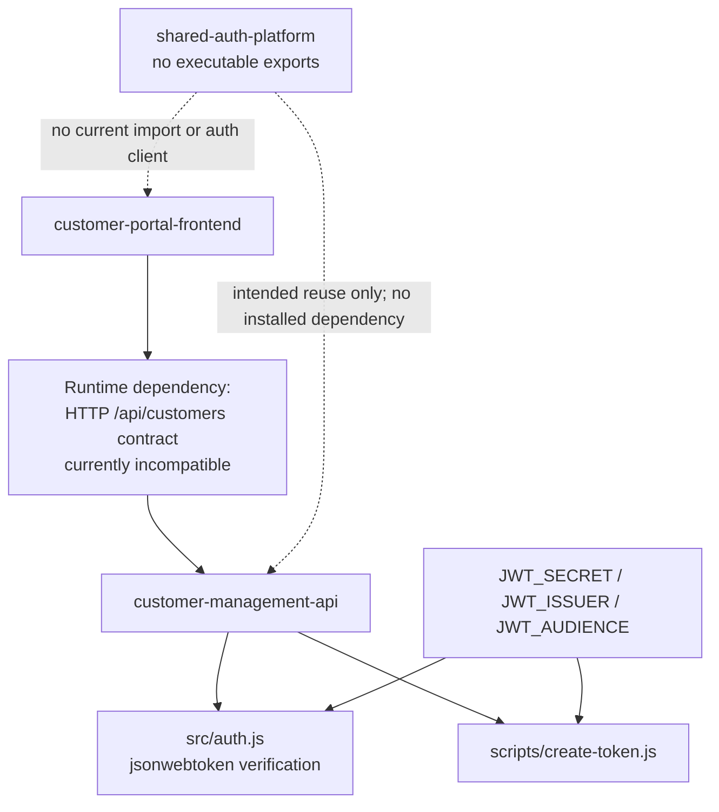

# System architecture

## Executive assessment

The demo consists of a React customer workspace and a separate Express REST API.
The frontend also has an explicitly selected in-memory demo adapter. The intended
shared authentication platform currently contains no implementation.

The live integration is **not compatible at this baseline**:

1. The browser requests a different origin, but the API has no CORS middleware or
   preflight handling.
2. The frontend requires `status` and `createdAt` on returned customers; the API
   does not supply either field.
3. Frontend creation sends `phone`, `industry`, and `status`; the API rejects
   these as unknown fields.

These are implementation gaps, not configuration-only issues. Successful API
calls from a terminal or a working standalone demo workspace do not demonstrate
successful frontend/API integration.

## Overall system diagram

Solid arrows represent implemented code paths; the browser-to-API path is coded
but blocked under the default local configuration. Dotted arrows show intended
relationships only.

```mermaid
flowchart LR
    Operator["Local developer"]
    Browser["Browser / React SPA<br/>customer-portal-frontend<br/>localhost:5173"]
    State["PortalProvider<br/>token and mode in React memory"]
    Live["CustomerService live adapter<br/>customers.ts + api.ts"]
    Demo["createDemoService<br/>tab-local customer data"]
    API["Express API<br/>customer-management-api<br/>localhost:4000"]
    Auth["createAuthMiddleware<br/>local HS256 verification"]
    Store["createCustomerStore<br/>per-app in-memory records"]
    CLI["scripts/create-token.js<br/>local token utility"]
    Config["Server-only JWT configuration"]
    Shared["shared-auth-platform<br/>README-only placeholder"]

    Operator -->|"run token utility"| CLI
    Config --> CLI
    Config --> Auth
    CLI -->|"developer manually pastes token"| Browser
    Browser --> State
    State -->|"live mode"| Live
    State -->|"explicit demo mode"| Demo
    Live -->|"HTTP JSON + Bearer JWT<br/>CORS and schema gaps"| API
    API -->|"/api/customers"| Auth
    Auth -->|"verified request"| Store
    API -->|"/health public"| Health["status: ok"]
    Shared -.->|"intended shared security utilities<br/>no package or runtime integration"| Auth
```



No database, message broker, API gateway, hosted identity provider, or deployment
platform is implemented in the inspected repositories. Local HTTP is a development
default, not a production transport recommendation.

## Repository responsibilities

### customer-portal-frontend

**Implemented:** React 19, TypeScript, Vite 7, React Router 7, browser Fetch API,
Lucide icons, and self-hosted Fontsource fonts. `package.json` defines the actual
build, lint, type-check, and Vitest scripts.

| Source path | Responsibility |
| --- | --- |
| `src/App.tsx` | Navigation, connection dialog, routes `/`, `/customers`, `/customers/new`, `/customers/:id`; `/dashboard` redirects to `/` |
| `src/state/PortalContext.tsx` | `PortalProvider` / `usePortal`; selects live versus demo service and holds the token in memory |
| `src/components/ConnectionDialog.tsx` | Manual token entry, mode selection, read-only configured API URL |
| `src/types/customer.ts` | `Customer`, `CreateCustomerInput`, `CustomerService`, `CustomerStatus` |
| `src/services/api.ts` | `createApiClient`, base URL, headers, Fetch transport, HTTP/network error mapping |
| `src/services/customers.ts` | `createCustomerService`, response envelope handling, runtime customer validation |
| `src/data/demo.ts` | Eight sample customers and isolated `createDemoService` implementation |
| `src/hooks/useAsync.ts` | Loading/error state, manual read retry, cancellation on navigation or service change |
| `src/pages/Dashboard.tsx` | Client-side customer metrics and creation-date charts |
| `src/pages/Customers.tsx` | Search, status filter, date sorting, eight-record pages, CSV export of all filtered records |
| `src/pages/CustomerDetails.tsx` | Customer lookup and profile display |
| `src/pages/CreateCustomer.tsx` | Form validation, create request, in-flight submission guard, visible save errors |
| `src/services/api.test.ts`, `src/App.test.tsx` | Mocked transport/service checks and workspace UI tests |

The directory URL parameters `q`, `status`, and `page` are UI state; they are not
implemented REST query parameters. CSV generation neutralizes spreadsheet formula
prefixes. Metrics are derived locally, not retrieved from a reporting endpoint.
The static "Workspace admin" label is not an authenticated role.

**Not implemented:** login/SSO, token refresh, customer update/delete, server-side
pagination, role management, audit logging, or backend infrastructure.

### customer-management-api

**Implemented:** Node.js CommonJS application using Express 5 and `jsonwebtoken`
9. No database or external service is required. Supertest is a development
dependency; `node --test` runs the API tests.

| Source path | Responsibility |
| --- | --- |
| `src/server.js` | Loads configuration and starts the HTTP listener |
| `src/config.js` | `loadConfig()` validates port and constructs authentication configuration |
| `src/app.js` | `createApp({ auth })`, public health route, protected customer router, fallback 404, error handler |
| `src/auth.js` | `validateAuthConfig`, `createAuthMiddleware`, local JWT verification and `req.auth` assignment |
| `src/customers.js` | `createCustomerStore`, two sample records, UUID generation, input validation, email uniqueness |
| `src/errors.js` | `ApiError` and consistent JSON error mapping |
| `scripts/create-token.js` | Local one-hour demo token issuance, not an HTTP endpoint |
| `test/api.test.js` | Isolated app-instance tests for authentication, validation, reads, creation, and errors |
| `.env.example`, `package.json` | Server variables, Node requirement, start/token/test commands |

Data belongs to each `createApp` instance: restarting resets it, and multiple
processes do not share writes or uniqueness checks. Reads return the complete
collection in insertion order. The public health endpoint only returns a static
liveness response; it does not verify end-to-end integration.

**Not implemented:** CORS configuration, persistent storage, customer update/delete,
pagination, per-user/per-tenant isolation, role/scope checks, rate limiting, or
identity-provider discovery.

### shared-auth-platform

**Intended:** "Shared authentication, authorization and reusable security utilities"
as stated in `README.md`.

**Implemented:** only `README.md` and `.gitignore` exist at the inspected revision.
There is no package manifest, source module, token issuer, HTTP server, endpoint,
JWKS document, configuration contract, or test suite. Neither application imports
or installs this repository. Do not start a third service or configure a fictitious
auth URL.

## Frontend-to-backend communication

1. `PortalProvider` starts in live mode unless `VITE_DEMO_MODE` is exactly `true`.
   It constructs `createCustomerService(() => token)` or selects the independent
   demo service. Changing mode does not migrate data.
2. Pages call the shared service interface:

   ```ts
   interface CustomerService {
     list(signal?: AbortSignal): Promise<Customer[]>
     get(id: string, signal?: AbortSignal): Promise<Customer>
     create(input: CreateCustomerInput): Promise<Customer>
   }
   ```

3. `src/services/customers.ts` maps these calls to `GET /customers`,
   `GET /customers/${encodeURIComponent(id)}`, and `POST /customers`.
   `src/services/api.ts` prefixes `VITE_API_BASE_URL`, default
   `http://localhost:4000/api`, removing trailing slashes.
4. Requests advertise `Accept: application/json`. Body-bearing requests set
   `Content-Type: application/json`; a nonempty token adds
   `Authorization: Bearer <token>`. There is no cookie-based auth flow or
   `credentials: 'include'` configuration.
5. The client checks HTTP success, parses JSON, unwraps an optional `data`
   envelope, and validates customer fields. The API always uses the envelope.
   The frontend accepts raw payloads too; that is client tolerance, not an
   alternative response emitted by this API.
6. Non-2xx results become `ApiError`s. Status 401 and 403 have specific UI text;
   other statuses use a generic message. Backend `error.code`, `message`, and
   `details` are not parsed by the client. A 204 becomes `null` at transport level,
   but customer parsing would reject it; none of the implemented endpoints returns
   204.
7. Read requests carry `AbortSignal`s and are canceled on navigation/service
   changes. Writes are not automatically retried; a failed network response
   does not prove that the server did not create the record.

The two localhost ports are different origins. An authorization header triggers
browser preflight even for GET requests. CORS is not enforced by `curl`, so
terminal success cannot resolve the browser gap. See [setup](local-setup.md) and
the [contract comparison](api-reference.md#frontend-contract-incompatibility).

## Cross-repository dependency map



| Relationship | Actual coupling | Change impact |
| --- | --- | --- |
| Frontend to API | HTTP paths, request fields, response schema, auth header, browser origin policy | Requires coordinated contract and CORS changes |
| Token utility to API verifier | Shared server configuration and HS256 signing/verification | Changing secret, issuer, audience, or algorithm invalidates existing tokens |
| Frontend to shared auth | None in source or dependency manifest | Any future login/client integration is new work |
| API to shared auth | None in source or dependency manifest | Extracting middleware requires a new package contract and migration |

The manifests contain no cross-repository package dependencies. There is no
orchestrator, shared release pipeline, or end-to-end integration test in the
inspected trees. The documentation repository is descriptive, not a runtime
dependency.

## Source baseline

Inspection date: **2026-11-05**. Source links below are pinned to immutable
revisions. File paths elsewhere in this documentation are relative to the named
repository at that revision. This baseline does not promise behavior of later
commits.

| Repository | Inspected commit | Source entry points |
| --- | --- | --- |
| `customer-portal-frontend` | `2509fb2739db00ce3b287e42b6ad98bbbd171690` | [Manifest](https://github.com/enterprise-ai-engineering-demo/customer-portal-frontend/blob/2509fb2739db00ce3b287e42b6ad98bbbd171690/package.json), [types](https://github.com/enterprise-ai-engineering-demo/customer-portal-frontend/blob/2509fb2739db00ce3b287e42b6ad98bbbd171690/src/types/customer.ts), [adapter](https://github.com/enterprise-ai-engineering-demo/customer-portal-frontend/blob/2509fb2739db00ce3b287e42b6ad98bbbd171690/src/services/customers.ts), [transport](https://github.com/enterprise-ai-engineering-demo/customer-portal-frontend/blob/2509fb2739db00ce3b287e42b6ad98bbbd171690/src/services/api.ts), [state](https://github.com/enterprise-ai-engineering-demo/customer-portal-frontend/blob/2509fb2739db00ce3b287e42b6ad98bbbd171690/src/state/PortalContext.tsx) |
| `customer-management-api` | `bd38112fe5726d24a0a5e507dea5a1eea7dc371a` | [Routes](https://github.com/enterprise-ai-engineering-demo/customer-management-api/blob/bd38112fe5726d24a0a5e507dea5a1eea7dc371a/src/app.js), [customers](https://github.com/enterprise-ai-engineering-demo/customer-management-api/blob/bd38112fe5726d24a0a5e507dea5a1eea7dc371a/src/customers.js), [auth](https://github.com/enterprise-ai-engineering-demo/customer-management-api/blob/bd38112fe5726d24a0a5e507dea5a1eea7dc371a/src/auth.js), [errors](https://github.com/enterprise-ai-engineering-demo/customer-management-api/blob/bd38112fe5726d24a0a5e507dea5a1eea7dc371a/src/errors.js), [token utility](https://github.com/enterprise-ai-engineering-demo/customer-management-api/blob/bd38112fe5726d24a0a5e507dea5a1eea7dc371a/scripts/create-token.js), [tests](https://github.com/enterprise-ai-engineering-demo/customer-management-api/blob/bd38112fe5726d24a0a5e507dea5a1eea7dc371a/test/api.test.js) |
| `shared-auth-platform` | `00808ed87edf42e7bf48a3a1b3e91b89097d4c94` | [README](https://github.com/enterprise-ai-engineering-demo/shared-auth-platform/blob/00808ed87edf42e7bf48a3a1b3e91b89097d4c94/README.md), [complete tree](https://github.com/enterprise-ai-engineering-demo/shared-auth-platform/tree/00808ed87edf42e7bf48a3a1b3e91b89097d4c94) |

Additional inspected frontend sources include `.env.example`, `vite.config.ts`,
`src/App.tsx`, `src/components/ConnectionDialog.tsx`,
`src/components/CustomerUI.tsx`, all four page modules, `src/hooks/useAsync.ts`,
`src/data/demo.ts`, `src/services/api.test.ts`, and `src/App.test.tsx`.
Additional backend sources include `package.json`, `.env.example`,
`src/config.js`, and `src/server.js`.

The endpoint inventory comes from route registration, not just repository README
claims. Tests were inspected as evidence of intended assertions; source review
does not establish that a deployed system or cross-repository integration passes.
